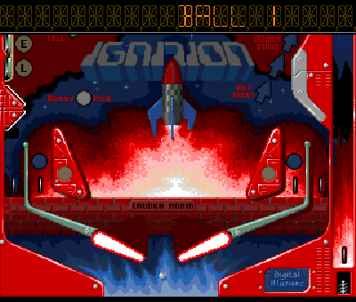
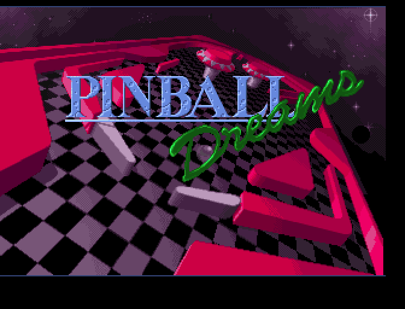
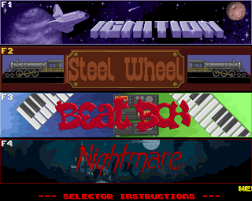
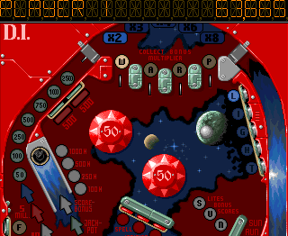
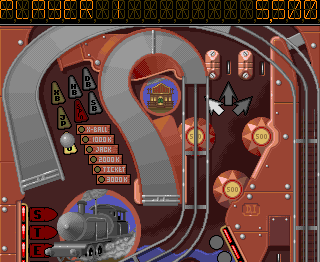
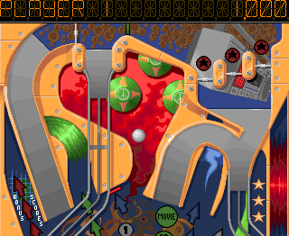
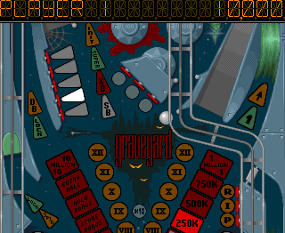
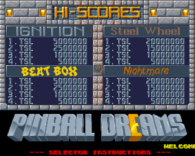
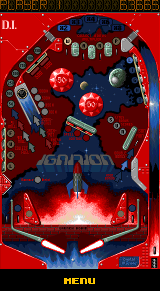

# Pinball Dreams Go

A native Go/Ebitengine remake of **Pinball Dreams** for desktop and Android.
Play all four original tables — **Ignition**, **Steel Wheel**, **Beat Box** and
**Nightmare** — with missions, ball locks, jackpots, bonus multipliers,
original music and sound effects. Games support up to eight alternating
players, and high scores are saved between sessions.



[Watch the full presentation video](media/pinballdreams-demo.mp4) ·
[WebM version](media/pinballdreams-demo.webm)

## Desktop

Go 1.26 or newer and a desktop graphics environment are required.
The runtime assets are included; no preparation step is needed to play.

```sh
go run .
```

Build and run a standalone executable:

```sh
make build
./bin/pinballdreams
```

Useful launch options:

```sh
go run . -menu                   # Open table selection directly.
go run . -table 1                # Open Ignition; tables are numbered 1–4.
go run . -touch                  # Preview the Android touch controls.
go run . -save-dir /path/to/data # Choose the high-score folder.
```

The game opens with the original title sequence and credits. Press Enter,
Escape or click to skip to table selection. Menus alternate with the rankings
screen. Tables retain the original 320 × 262 scrolling view and approximately
49.92 Hz gameplay cadence, with nearest-neighbor scaling.

## Controls

| Input | Action |
| --- | --- |
| F1–F4 in selection or rankings | Select Ignition, Steel Wheel, Beat Box or Nightmare |
| F1–F8 on a table | Start a game for one to eight players |
| Enter on a table | Start a game or add a player before the first ball enters play |
| Left / right Shift, Alt or Meta | Operate the corresponding flipper |
| Left / right arrow, Z / slash | Alternative left / right flipper controls |
| Hold Down, then release | Pull the spring and launch |
| Move the mouse down, then left-click | Pull and release the spring |
| Space during play | Nudge the table; excessive nudging causes tilt |
| P | Pause; press a fresh key to resume |
| Escape, then Y | Leave the table; N cancels the question |
| Escape with the ball in the spring lane | Cancel the current game |
| M | Toggle music while retaining sound effects |
| Space in selection or rankings | Switch between the two screens |
| Letters, digits or spaces | Enter three high-score initials |
| Backspace / Enter during initials | Erase / finish with spaces |

Desktop table controls capture the mouse. Pause, the quit question and loss of
focus release it. Use `-touch` for ordinary pointer interaction instead.
The default high-score folder is `PinballDreams` inside the system user
configuration directory.

## Android

The Android build requires Go 1.26+, Java 17 or 21, Android SDK 36,
Android Build Tools 36.0.0 and Android NDK 28.2.13676358. Set `ANDROID_HOME`,
`ANDROID_NDK_HOME` and `JAVA_HOME` when the tools are installed elsewhere.

Build the ARM64 debug APK:

```sh
make android
```

Build, install and launch on one authorized USB device:

```sh
make android-run
```

Set `ANDROID_SERIAL` when more than one device is connected. The APK is written
to:

```text
android/app/build/outputs/apk/debug/app-debug.apk
```

Tap a table strip to select it, then tap the table to start. Hold the left and
right regions for independent flippers. Hold the lower center or bottom-right
spring area, then release to launch; tap the upper center to nudge. Tap the
player prefix to add players before the first ball enters play, or the right
end of the score display to toggle music.

Portrait shows the entire table; landscape uses the scrolling view. A control
bar below the original image provides MENU, SCORES and initials controls.
MENU or Android Back opens Resume, Restart and Choose Table actions. Rotation
and returning from the background pause play and cancel held spring gestures.

## Screenshots

| Title | Table selection |
| --- | --- |
|  |  |

| Ignition | Steel Wheel |
| --- | --- |
|  |  |

| Beat Box | Nightmare |
| --- | --- |
|  |  |

| High scores | Android portrait layout |
| --- | --- |
|  |  |

## Original game credits

**Pinball Dreams** was developed by **Digital Illusions** and published by
**21st Century Entertainment** in **1992**. The original credits name
**Andreas Axelsson** and **Ulf Mandorff** for programming, **Markus Nyström**
for graphics, **Olof Gustafsson** for music and sound effects,
**Fredrik Liliegren** for project management and **Barry Simpson** as producer.

Pinball Dreams, its name, artwork, audio and original game data remain the
property of their respective rights holders. This independent remake is not
affiliated with or endorsed by them.

No Amiga disk image is distributed in this repository. See [ADF.md](ADF.md)
for the reference version used by the project.
